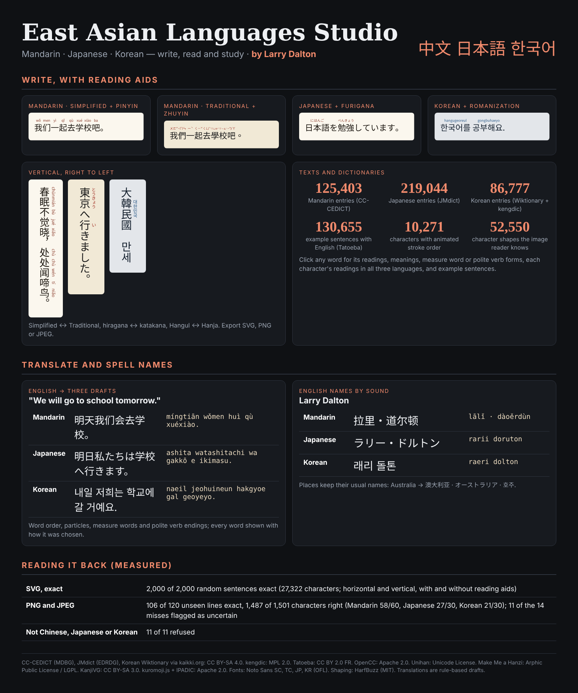
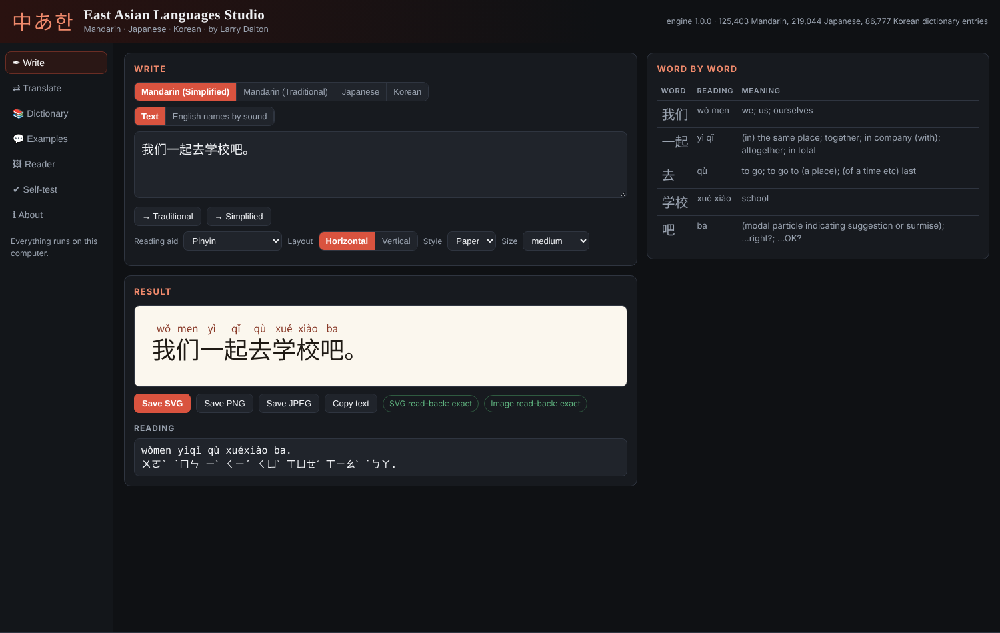
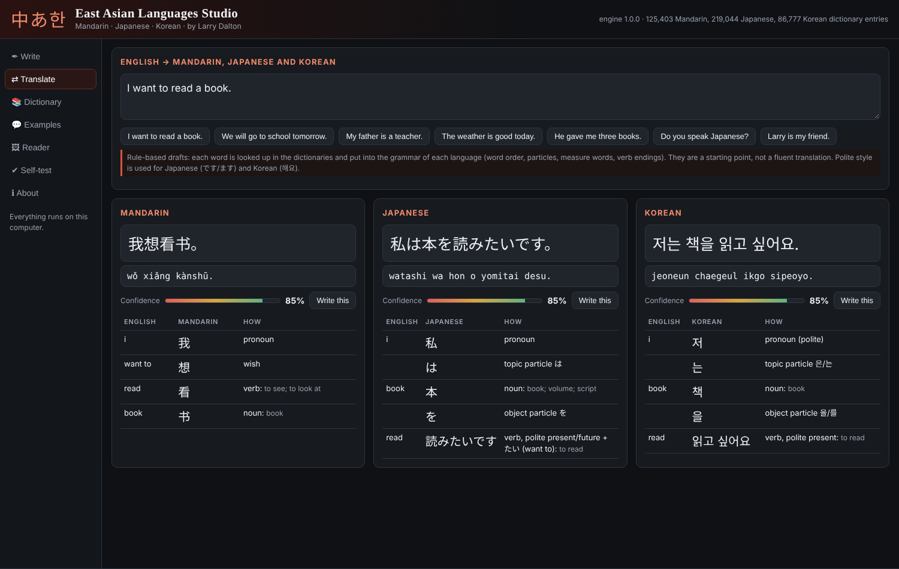
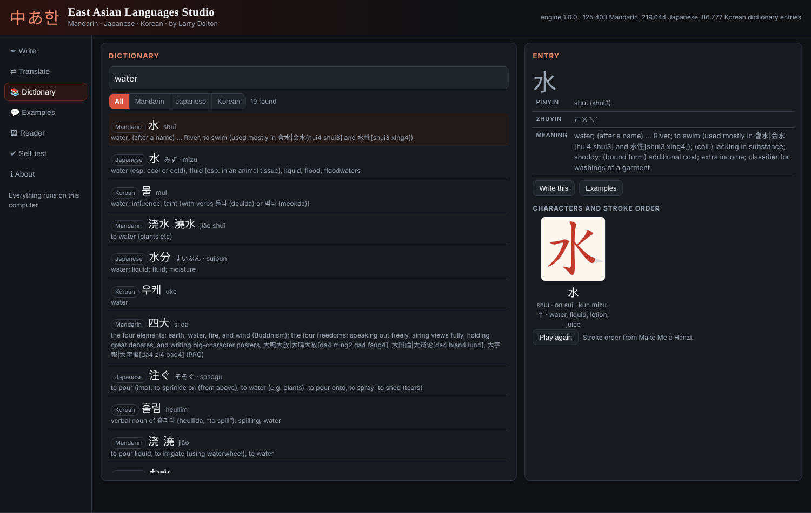

<h1 align="center">East Asian Languages Studio</h1>

<b>Write, read and study Mandarin Chinese, Japanese and Korean. By Larry Dalton.</b> 
A local Windows studio with three dictionaries, stroke order, example sentences, English to Mandarin/Japanese/Korean drafts, names by sound, and a reader for SVG and images.

<a href="../../releases/latest"><b>Download for Windows</b></a> ·
<a href="docs/HOW-IT-WORKS.md">How it works</a> ·
<a href="docs/READER.md">Reader and test results</a> ·
<a href="NOTICE.md">Credits and licences</a>

---

## What it does

| Area | What you get |
|---|---|
| **Write** | Mandarin in Simplified or Traditional characters with **pinyin** or **zhuyin** (bopomofo); Japanese with **furigana** or **romaji** (Hepburn); Korean with **Revised Romanization** (with the sound changes: 독립문 → dongnimmun) or Hangul over Hanja. Horizontal, or **vertical** right to left. Converts Simplified ⇄ Traditional (Taiwan forms), hiragana ⇄ katakana, Hangul ⇄ Hanja, and romaji → kana. Export SVG, PNG or JPEG in four styles. |
| **Names by sound** | English names in all three languages: *Larry Dalton* → 拉里·道尔顿 · ラリー・ドルトン · 래리 돌톤. Places keep their usual names (Australia → 澳大利亚 · オーストラリア · 호주). |
| **Word by word** | Every sentence split into words with readings and meanings (Japanese is split with kuromoji; Korean endings and particles are separated: 학교에서 → 학교 + 에서). Click a word to open it in the dictionary. |
| **Dictionary** | 125,403 Mandarin (CC-CEDICT), 219,044 Japanese (JMdict) and 86,777 Korean (Wiktionary + kengdic) entries. Search in English, characters, kana, Hangul, pinyin (`ni3hao3` or `nihao`) or romaji. Entries show readings, measure words, polite Korean verb forms, each character's Mandarin, Japanese and Korean readings, and **animated stroke order** for 10,271 characters. |
| **Examples** | 130,655 Tatoeba sentences with English, with readings, searchable by word or English. |
| **Translate** | Rule-based English → Mandarin, Japanese and Korean **drafts**: word order (SVO / SOV), particles (は を に で / 은·는 을·를 에서), measure words (三本书), past and future, negation, polite Japanese (ます) and Korean (해요) verb endings. *We will go to school tomorrow.* → 明天我们会去学校。 · 明日私たちは学校へ行きます。 · 내일 저희는 학교에 갈 거예요. Each word shows how it was chosen, what the studio could check (sentence pattern, English words it could not use), and a human translation from Tatoeba when one exists for the same English. **Measured** on 1,800 short Tatoeba sentences: drafts matched a human translation exactly only 2% of the time in Mandarin and under 1% in Japanese and Korean, and shared on average 55% / 44% / 41% of their characters with the closest human translation. They are rough guides. |
| **Reader** | Reads the studio's SVGs exactly, and PNG/JPEG images of Chinese, Japanese and Korean text in the studio's fonts, horizontal or vertical. |

## Reading it back (measured)

| Test | Result |
|---|---|
| SVG read-back, 2,000 random Tatoeba sentences (500 per script), horizontal and vertical, with and without reading aids | **2,000 / 2,000** exact (27,322 characters) |
| 120 new random sentences as PNG/JPEG, 0.6× to 2×, four styles, some vertical, some with reading aids (made after tuning, not used for it) | **106 / 120 exact**; **1,487 of 1,501 characters** right. Mandarin 58/60, Japanese 27/30, Korean 21/30. 11 of the 14 misses were flagged as uncertain. |
| Images that are not Chinese, Japanese or Korean (Latin, noise, icon, hieroglyphs, cuneiform, Hebrew/Greek, pIqaD, Heptapod) | **11 / 11 refused** (these images were also used to set the refusal rule) |
| Built-in self-test, in the studio page | **26 passed, 0 failed** |

Limits: reading aids (pinyin, furigana, romanization) are not read from images, only from SVG; Korean is the weakest in images (similar vowels such as ㅡ/ㅜ and ㅓ/ㅕ at small sizes); Simplified and Traditional can only be told apart when the text has characters that differ; translations are rough drafts (see the measured figures above). **Use SVG for exact results.** Details: [docs/READER.md](docs/READER.md).

## Install (Windows 10/11)

**Option 1: setup program.** Download `EastAsianLanguagesStudio-Setup.exe` from the [latest release](../../releases/latest) and run it.

- Installs for your Windows account only; no administrator rights needed.
- Runs at **http://localhost:8770/** and starts when you sign in (Bible Languages Studio uses 8769 and Cuneiform Studio 8768, so they can all run together).
- Puts the infographic on your Desktop and adds a Start-menu entry and an uninstaller in *Settings → Apps*.

The setup program is not code-signed, so SmartScreen may warn: choose **More info → Run anyway**.

**Option 2: ZIP.** Download `EastAsianLanguagesStudio-Package.zip`, extract it and double-click `Install.cmd`.

The installer checks all three dictionaries, the stroke data, the Japanese word splitter, the fonts, the character templates and the text shaper over HTTP, and puts your previous version back if any check fails. Everything runs on your computer; nothing is sent anywhere.

## Repository

| Folder | Contents |
|---|---|
| `src/app` | The studio (`index.html`, `engine.js`), data, fonts, HarfBuzz, kuromoji and licences |
| `src/server.ps1` | The small local web server (Windows PowerShell 5.1) |
| `installer` | `Install.ps1`, `Uninstall.ps1`, `eastasian.nsi` (NSIS setup), `Install.cmd`, update script |
| `tools` | Data, font and template builders, infographic generator: see [tools/README.md](tools/README.md) |
| `test` | Round-trip, image and refusal tests: see [test/README.md](test/README.md) |

Credits and licences: [NOTICE.md](NOTICE.md). Dictionary data derived from CC-CEDICT, JMdict and Wiktionary is CC BY-SA 4.0.
